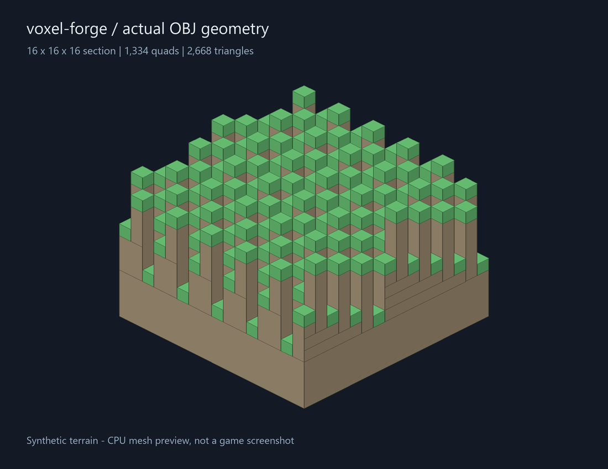

# voxel-forge

Compact voxel sections and neighbor-aware greedy meshing in Rust.

`voxel-forge` is a small CPU library for developers building editable, full-cube
voxel worlds. It combines palette storage, checked world coordinates, and a
deterministic mesher behind one renderer-independent API. It has no dependencies
and forbids unsafe Rust.

**Status:** local pre-release, version 0.1.0. The crate has not been published to
crates.io. Public adoption and compatibility with third-party engines have not
been established. The package name is provisional until registry availability
is checked.



Synthetic OBJ geometry rendered by `docs/render_preview.py`, not a game screenshot.

## What works

- Sections contain 16 × 16 × 16 application-defined `u32` IDs. Zero means air.
- Empty and uniform sections use no heap allocation. Mixed sections use
  palette indices packed at 1–12 bits, including across word boundaries.
- Edits reuse dead palette slots, collapse uniform data automatically, and
  support explicit compaction. Bulk replacement can reuse allocated buffers.
- Greedy meshing merges adjacent visible faces of the same material. Six
  optional neighboring sections suppress shared internal faces.
- Reusable mesher scratch and output buffers avoid fresh per-voxel allocations.
- Signed 64-bit world coordinates split correctly at negative section borders;
  conversion and neighbor offsets detect overflow.

The storage and coordinate code were extracted and adapted from a local
Rust/Vulkan voxel engine. The full-cube mesher was written for this standalone
API. See [provenance](PROVENANCE.md).

## Try it

Rust 1.85 or newer is the declared minimum. Local verification currently uses
Rust 1.99 on Windows; the supplied CI also checks the minimum version.

From this directory:

```console
cargo test --offline
cargo run --release --offline --example terrain -- terrain.obj
cargo bench --offline --bench core
cargo doc --offline --no-deps --open
```

The example writes a real OBJ mesh with two material groups. Import it into an
OBJ-capable viewer; +Y is up and one unit is one voxel. It has 1,334 quads
(2,668 triangles) covering 3,072 visible unit faces.

To use the local checkout from another Rust project:

```toml
[dependencies]
voxel-forge = { path = "../voxel-forge" }
```

```rust
use voxel_forge::{
    Face, GreedyMesher, LocalPos, Mesh, Neighborhood, SectionStorage, VoxelId,
};

fn main() -> Result<(), voxel_forge::VoxelError> {
    let mut section = SectionStorage::filled(VoxelId::new(1));
    section.set(LocalPos::new(4, 15, 4)?, VoxelId::AIR);

    let adjacent = SectionStorage::filled(VoxelId::new(2));
    let input = Neighborhood::new(&section)
        .with_neighbor(Face::PositiveX, &adjacent);

    let mut mesher = GreedyMesher::default();
    let mut mesh = Mesh::default();
    mesher.mesh(&input, &mut mesh);

    for quad in mesh.quads() {
        let positions = quad.vertices();
        // Upload these vertices and triangles (0,1,2), (0,2,3) to your renderer.
        // Vertices are counterclockwise viewed from outside.
        let material_id = quad.material.raw();
        let _ = (positions, material_id);
    }
    Ok(())
}
```

Missing neighbors are air. Remesh both touching sections when a neighbor loads,
unloads, or changes on the boundary. The library does not schedule this work.
Storage order is X, then Z, then Y: `index = y * 256 + z * 16 + x`.

## Measured behavior

One local optimized run on an AMD Ryzen 7 5800H, Windows 11, Rust 1.99:

| Fixture | Visible unit faces | Quads | Used storage heap | Mesh median time |
| --- | ---: | ---: | ---: | ---: |
| Empty | 0 | 0 | 0 B | 59.920 µs |
| Solid | 1,536 | 6 | 0 B | 87.648 µs |
| Synthetic terrain | 3,072 | 1,334 | 1,048 B | 104.872 µs |
| Air/solid checkerboard | 12,288 | 12,288 | 528 B | 164.956 µs |
| 4,096 unique solid IDs | 1,536 | 1,536 | 38,912 B | 146.200 µs |

Storage also has 56 inline bytes on this target. A dense `[u32; 4096]` is
16,384 bytes. High-entropy palettes can cost **more** than dense storage;
there is currently no automatic dense fallback. Mesher scratch is 23,552 bytes
and each output quad is 12 bytes on this target. These are owned buffer sizes,
not process RSS or allocator totals.

Times are medians of 41 batch means, with 25 calls per batch, after warming
output capacity. They exclude storage construction, GPU work, and rendering.
They are neither frame rates nor single-call latency percentiles, and do not
establish performance relative to other libraries. See the [method and raw
data](benchmarks/README.md) for reproduction and limitations.

## Scope and tradeoffs

Only opaque unit cubes are supported. All nonzero IDs occlude each other;
different IDs never merge. There are no transparent faces, fluids, slabs,
lighting, ambient occlusion, UV atlases, persistence, networking, LOD, GPU
resources, or game assets in this package.

The palette uses linear material lookup during edits and bulk construction.
It targets low material diversity; construction and editing can degrade with
thousands of distinct IDs. Meshing decodes a section once, then scans six face
directions. It currently scans even empty sections. Thread scheduling and
dirty-section tracking belong to the caller.

The 0.1 API is experimental. No claim of being the fastest or production proven
is made. Next work is driven by reproducible integration problems, not by
adding a full game engine; see [planned issues](docs/INITIAL_ISSUES.md).

## Contributing

Useful first contributions include an integration example, independent
benchmark reproduction, or a minimal failing voxel arrangement. See
[CONTRIBUTING.md](CONTRIBUTING.md). GitHub issue forms and a CI workflow are
included for use when this directory becomes a public repository. They have
not yet run on hosted runners.

## License

[MIT](LICENSE). The license covers this extracted package; it does not license
the surrounding engine or its assets.
